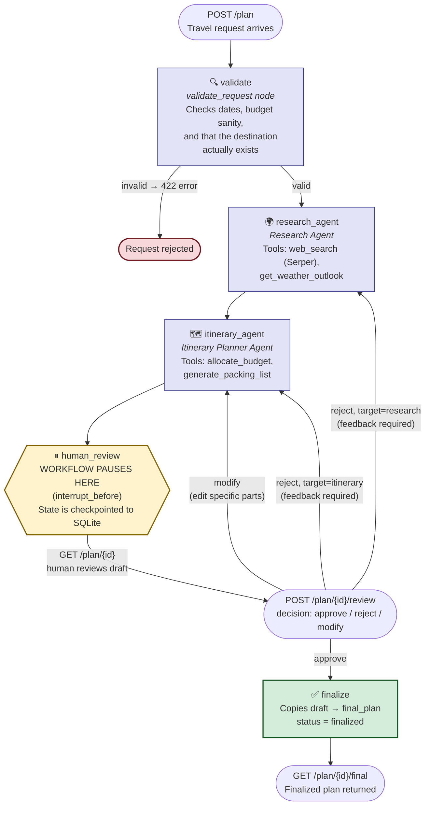
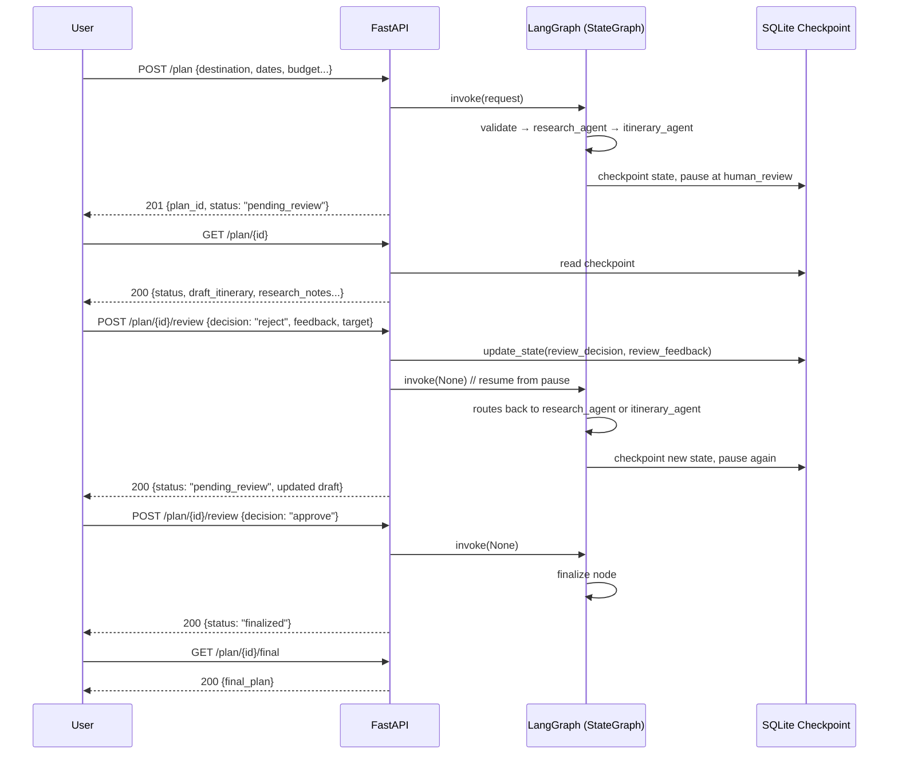

# AI Travel Planner

A multi-agent travel planning system built with **LangGraph** and **FastAPI**.
Given a destination, dates, budget, and interests, it researches the trip,
drafts a day-by-day itinerary, pauses for **human-in-the-loop (HITL)
approval**, and produces a finalized plan — all while persisting state
across the pause so nothing is lost if the process restarts.

---

## Table of Contents

1. [Overview](#overview)
2. [Architecture](#architecture)
3. [Why these agents and tools](#why-these-agents-and-tools)
4. [Project structure](#project-structure)
5. [Setup instructions](#setup-instructions)
6. [Running the app](#running-the-app)
7. [API reference + example requests](#api-reference--example-requests)
8. [Design decisions & tradeoffs](#design-decisions--tradeoffs)
9. [Assumptions made](#assumptions-made)
10. [What I'd improve with more time](#what-id-improve-with-more-time)
11. [Production concerns](#production-concerns)

---

## Overview

A user submits a travel request (destination, dates, budget, interests,
number of travelers). The system:

1. **Validates** the request (structurally and semantically — e.g. does the
   destination actually exist?).
2. **Researches** the destination (attractions, safety, weather, seasonal
   notes) using a web-search agent.
3. **Plans** a day-by-day itinerary, budget split, and packing list using a
   second agent that consumes the research output.
4. **Pauses** and hands the draft to a human for review.
5. Based on the human's decision — **approve**, **reject with feedback**, or
   **modify** — either **finalizes** the plan or **routes back** to the
   right agent to revise it.

The whole thing is one LangGraph `StateGraph`, served through a FastAPI app,
with state checkpointed to SQLite so the pause is a real pause — not an
in-memory wait that dies if the server restarts.

---

## Architecture



**How to read this:** every box except `human_review` is a LangGraph node
that runs automatically. The diamond (`human_review`) is where LangGraph's
`interrupt_before` genuinely stops execution — the graph is frozen mid-run,
with its entire state (research notes, draft itinerary, feedback history)
written to a SQLite checkpoint keyed by `plan_id`. It stays frozen until a
human calls `POST /plan/{id}/review`, at which point the graph resumes from
exactly where it paused — not from scratch.

### Request lifecycle (sequence view)



---

## Why these agents and tools

The assignment allows freedom on several choices. Here's the reasoning
behind each one:

### Why two agents, split this way (Research vs. Itinerary)

The split follows a natural **information dependency**: you cannot plan a
day-by-day schedule, budget allocation, or packing list until you know
*what exists at the destination* and *what the weather will be like*. Making
Research a strict upstream step (rather than one agent doing everything)
means:
- Each agent's system prompt stays focused and short, which makes the LLM
  more reliable at each sub-task.
- A "reject" review can target *either* agent independently — if the
  research was wrong (e.g. missed a festival), you don't need to also
  discard a perfectly good itinerary structure, and vice versa.

### Why Groq (not OpenAI/Anthropic) as the LLM provider

The assignment explicitly allows any provider. Groq was chosen because:
- It's **free-tier friendly** for a take-home project with no billing setup.
- It's **fast** (LPU-based inference), which matters here since a single
  `/plan` call runs two full agent loops (research + itinerary), each with
  tool calls — slow inference would compound badly.
- It's **OpenAI-API-compatible**, so if a reviewer wants to swap in a
  different provider, `app/config.py` is the only file that needs to
  change — the rest of the codebase (LangChain/LangGraph agents) is
  provider-agnostic.

### Why Serper (not Exa) for the mandatory web-search tool

Both are allowed; Serper was picked because it returns results in a
Google-SERP-like shape (answer boxes, organic snippets with links) that
map cleanly onto what a travel-research prompt actually needs — quick,
citable facts about attractions and safety — without needing to tune a
neural-search relevance model the way Exa is designed for. Exa's free tier
is genuinely a fine alternative; this was a "pick one and move on" decision,
not a case where the other option was worse.

### Why Open-Meteo for weather (the "your choice" Research tool)

Weather materially changes both the itinerary (indoor vs. outdoor days) and
the packing list, so it earns a dedicated tool rather than relying on the
web-search agent to stumble onto a weather article. Open-Meteo was chosen
because it's **free with no API key**, which keeps setup friction low for
anyone running this project, and returns clean structured daily data
(temperature range, rain probability) rather than prose that would need
parsing.

### Why a Budget Allocator + Packing List Generator (the "your choice" Itinerary tools)

These two were picked over alternatives (e.g. a restaurant recommender or
events lookup) because they directly satisfy fields already required by the
travel request (`budget_min`/`budget_max`, `interests`) and produce
**verifiable, structured output** (numbers, lists) rather than more free
text — which matters for a HITL review flow, since a human reviewing a
draft plan benefits far more from "see exactly how the ₹80,000 was split"
than from another paragraph of prose. The budget tool also respects an
optional `budget_weights` field on the request, so a traveler who *does*
have a preference (e.g. "spend more on food, less on lodging") has that
preference enforced by the tool, not silently overridden by the LLM.

---

## Project structure

```
AI_Travel_Planner/
├── app/
│   ├── main.py               # FastAPI app + all 4 endpoints + serves the UI at /
│   ├── static/index.html     # Web UI (form, review, final plan)
│   ├── graph.py               # LangGraph StateGraph (the orchestrator)
│   ├── state.py                # WorkflowState + all Pydantic request/response models
│   ├── validation.py          # Request validation (dates, budget, destination geocoding)
│   ├── config.py               # LLM provider setup (Groq) + env vars
│   ├── agents/
│   │   ├── research_agent.py   # Agent 1: destination research
│   │   └── itinerary_agent.py  # Agent 2: itinerary construction
│   └── tools/
│       ├── web_search.py       # Serper API (mandatory tool)
│       ├── weather.py          # Open-Meteo forecast (Research agent's 2nd tool)
│       ├── budget.py           # Budget allocator (Itinerary agent's 1st tool)
│       └── packing.py          # Packing list generator (Itinerary agent's 2nd tool)
├── data/                        # SQLite checkpoint DB lives here (gitignored)
├── requirements.txt
├── .env.example                 # Template — copy to .env and fill in your own keys
└── README.md
```

---

## Setup instructions

### Prerequisites
- Python 3.11+
- A free [Groq](https://console.groq.com) API key
- A free [Serper](https://serper.dev) API key (2,500 free queries on signup)

### Steps

```bash
# 1. Clone the repo
git clone <your-repo-url>
cd AI_Travel_Planner

# 2. Create and activate a virtual environment
python -m venv venv
source venv/bin/activate        # Windows: venv\Scripts\activate

# 3. Install dependencies
pip install -r requirements.txt

# 4. Configure environment variables
cp .env.example .env
# then open .env and paste in your own GROQ_API_KEY and SERPER_API_KEY
```

`.env.example` should contain (no real secrets):

```
GROQ_API_KEY=
LLM_MODEL=llama-3.3-70b-versatile
SERPER_API_KEY=
DATABASE_PATH=./data/checkpoints.sqlite
```

> ⚠️ Never commit a `.env` with real keys. Only `.env.example` (with blank
> values) should be tracked in git.

---

## Running the app

```bash
uvicorn app.main:app --reload
```

The web UI is at `http://localhost:8000/` and the API is live on the same address.
Interactive docs (Swagger UI, auto-generated by FastAPI): `http://localhost:8000/docs`

---

## API reference + example requests

### 1. `POST /plan` — submit a new travel request

**Request:**
```json
{
  "destination": "Jaipur, India",
  "start_date": "2026-09-10",
  "end_date": "2026-09-13",
  "budget_min": 30000,
  "budget_max": 40000,
  "interests": ["heritage", "food", "shopping"],
  "num_travelers": 2,
  "budget_weights": { "food_pct": 0.35 }
}
```

**Response — `201 Created`:**
```json
{
  "plan_id": "8f1a2e3b-...",
  "status": "pending_review"
}
```

### 2. `GET /plan/{id}` — check status / view the draft

**Response — `200 OK`:**
```json
{
  "plan_id": "8f1a2e3b-...",
  "status": "pending_review",
  "research_notes": "Jaipur — City Palace, Hawa Mahal...\nWeather: ...",
  "weather_outlook": "Weather outlook for Jaipur:\n- 2026-09-10: 26-34°C, 40% chance of rain\n...",
  "draft_itinerary": {
    "destination": "Jaipur, India",
    "budget_allocation": { "lodging": 12000, "food": 14000, "...": "..." },
    "days": [ { "day": 1, "date": "2026-09-10", "activities": [ "..." ] } ],
    "packing_list": [ "Lightweight breathable clothing", "..." ]
  },
  "feedback_history": []
}
```

### 3. `POST /plan/{id}/review` — approve, reject, or modify

**Reject example:**
```json
{
  "decision": "reject",
  "feedback": "Day 2 is too packed — spread the Amber Fort visit across half a day only.",
  "target": "itinerary"
}
```

**Modify example:**
```json
{
  "decision": "modify",
  "feedback": "Swap the shopping activity on Day 3 for a cooking class instead.",
  "target": "itinerary"
}
```

**Approve example:**
```json
{ "decision": "approve" }
```

**Response — `200 OK`** (shape matches `GET /plan/{id}`, with updated `status` and, on rejection/modification, an updated `draft_itinerary` and appended `feedback_history`.)

### 4. `GET /plan/{id}/final` — retrieve the finalized plan

Returns `409 Conflict` if called before approval. After approval:

```json
{
  "plan_id": "8f1a2e3b-...",
  "status": "finalized",
  "final_plan": { "...": "same shape as draft_itinerary" }
}
```

---

## Design decisions & tradeoffs

Being upfront about the calls made and what they cost:

**1. SQLite checkpointing over in-memory state.**
Chosen so a pause is a *real* pause — the process can restart and a
`POST /plan/{id}/review` will still resume correctly, since state lives on
disk keyed by `plan_id` (used as the LangGraph `thread_id`). Tradeoff:
SQLite doesn't handle concurrent writers well at scale — fine for a
single-instance demo, wrong for multi-instance production (see
[Production concerns](#production-concerns)).

**2. Destination validation calls Nominatim (OpenStreetMap) live, with caching.**
To catch real input errors (e.g. `"New York, Germany"`) rather than just
checking "is this a non-empty string," `validation.py` geocodes both the
city and the stated country and compares ISO country codes — with no
hardcoded alias list, so it works for any country without maintenance.
This adds an external dependency and latency to every `/plan` call.
Mitigations already in place: results are cached in-process
(`lru_cache`), the timeout is kept short (4s) so a slow response fails
fast rather than blocking the request, and a `429` rate-limit response is
explicitly distinguished from "place not found" so Nominatim throttling
never produces a false rejection. At true production scale, this would
need to move to a paid geocoding provider with an SLA (Google Geocoding,
Mapbox, LocationIQ) instead of Nominatim's free ~1 req/sec tier.

**3. Tool-output-as-source-of-truth, not LLM prose, for critical fields.**
Both agents re-read the raw tool call results directly from the LangGraph
message transcript (`_last_tool_output` / `_last_tool_text`) rather than
trusting the LLM to faithfully copy tool results into its final JSON.
Concretely: the budget tool's `weights_used`/`weights_source` fields are
force-merged back into the draft after the LLM responds, so a reviewer can
always verify whether the human's stated budget split was actually honored
— even if the LLM's prose summary dropped or rounded it. Same pattern for
weather: if the LLM's `weather_summary` comes back empty, the raw tool
output captured during research is used as a fallback. Tradeoff: this adds
non-trivial post-processing code around each agent call, versus trusting
the LLM output as-is — but it converts "hope the LLM was faithful" into
"guaranteed by code," which matters for the parts of the output a human
reviewer needs to trust.

**4. Bounded single retry if the itinerary has the wrong number of days.**
LLMs occasionally collapse or truncate multi-day itineraries. Rather than
silently accepting a 2-day plan for a 5-day trip, `run_itinerary` checks
the day count and, if wrong, sends one corrective follow-up message before
giving up. Tradeoff: this can roughly double latency on that one call in
the worst case, but only if the first attempt was actually wrong.

**5. HITL review endpoint isn't guarded against concurrent requests on the same plan.**
`POST /plan/{id}/review` checks `status == "pending_review"`, then calls
`update_state()` followed by `invoke()` to resume the graph — but that
check-then-act sequence isn't atomic. If two review requests hit the same
`plan_id` at nearly the same instant (FastAPI runs sync endpoints in a
thread pool, so this is possible), both could pass the status check before
either one finishes resuming the graph. This is a narrow race window and
unlikely to matter for a single-user demo, but it's a real gap: a
production version would need a per-`plan_id` lock (or an
optimistic-concurrency check using the checkpoint's version/timestamp)
around the read-check-write sequence to close it properly.

**6. A single-file web UI served by FastAPI.**
`app/static/index.html` is a dependency-free page (plain HTML/CSS/JS) served at `/`. It talks to the same four endpoints as the Swagger UI, so the API stays the single source of truth. It mirrors the key validation rules client-side, shows the weather per day, and disables the target picker for `modify` because the graph always routes `modify` to the itinerary agent. Recent plan IDs are kept in the browser's localStorage; the plans themselves stay in the SQLite checkpoint. Swagger UI at `/docs` is still available.

---

## Assumptions made

- All monetary amounts (`budget_min`, `budget_max`, budget allocations) are
  in **INR (₹)** — the request schema doesn't include a currency field, so
  a single currency was assumed for simplicity.
- `num_travelers` applies uniformly to the whole trip (no support for
  travelers joining/leaving mid-trip).
- A rejected/modified review always targets either `"research"` or
  `"itinerary"` as a whole phase — there's no fine-grained "redo only Day 3"
  targeting at the API level; that level of specificity is instead expressed
  through the natural-language `feedback` field, which the itinerary agent
  is prompted to apply surgically to the previous draft rather than
  regenerating everything from scratch.
- A single LLM provider (Groq) and a single model serve both agents. Using
  different models per agent (e.g. a cheaper/faster model for research, a
  stronger one for itinerary construction) was assumed out of scope for
  this take-home.
- The destination validation assumes the traveler writes destinations in a
  roughly `"City"` or `"City, Country"` format. Ambiguous inputs without a
  country (e.g. just `"Springfield"`) are accepted as long as *a* matching
  place is found — country-mismatch detection only triggers when a country
  is actually stated.
- Only one round of the HITL loop is assumed "normal usage" per request in
  the examples above, but the graph itself supports unlimited
  reject/modify cycles — `revision_count` is tracked but not currently
  capped.

---

## What I'd improve with more time

1. **Write a proper test suite.** Currently there are no automated tests.
   I'd add: unit tests for `validation.py` (date logic, budget sanity,
   mocked geocoding responses including a simulated 429), and integration
   tests hitting the FastAPI app with `TestClient` for the full
   plan → review → final lifecycle, including reject and modify branches.
2. **Cap `revision_count` and expose it meaningfully.** Right now a plan can
   be rejected indefinitely. I'd add a max-revisions limit with a clear
   error/status once exceeded, to prevent an unbounded LLM-cost loop.
3. **Add a mock/deterministic LLM mode for local dev and CI.** Every
   `/plan` call currently costs real tool calls + real LLM tokens, which
   makes fast iteration and CI runs slower/costlier than necessary.
4. **Streaming status updates.** `GET /plan/{id}` requires polling. A
   WebSocket or SSE endpoint would let a client watch the workflow progress
   (`researching → planning → pending_review`) live instead of polling.
5. **Structured, field-level "modify" instead of freeform feedback only.**
   e.g. `{"day": 2, "activity_index": 1, "replace_with": "..."}` as an
   optional alternative to natural-language feedback, for clients that want
   deterministic partial edits without an LLM round-trip at all.
6. **Move destination geocoding off the request's critical path**, per the
   tradeoff discussed above — either as an async background check surfaced
   via polling, or swapped for a paid provider with better throughput
   guarantees.
7. **Per-agent model selection** — e.g. a smaller/cheaper model for the
   more mechanical research-summarization step, reserving a stronger model
   for the itinerary construction step where structured JSON correctness
   matters most.

---

## Production concerns

If this were going to real users rather than staying a take-home demo:

- **Checkpointer**: swap `SqliteSaver` for `PostgresSaver` (LangGraph
  supports this natively). SQLite doesn't handle concurrent writes safely
  across multiple app instances, which any real deployment would have
  behind a load balancer.
- **Secrets management**: API keys currently live in `.env`. In production
  these belong in a secrets manager (AWS Secrets Manager, GCP Secret
  Manager, Vault) — never in a file that could accidentally be committed.
  (`.env` is `.gitignore`d in this repo; only `.env.example` is tracked.)
- **Rate limiting and auth on the API itself**: right now anyone who can
  reach `/plan` can trigger LLM + tool calls at will. A real deployment
  needs per-user auth and rate limiting to control cost and abuse.
- **Idempotency / retries**: `POST /plan` and `POST /plan/{id}/review`
  aren't currently idempotent — a client retry on a network blip could
  double-submit a review action. I'd add an idempotency-key pattern.
- **Observability**: currently just Python's `logging` module at INFO
  level. Production would want structured logs, tracing across the
  LangGraph node boundaries (which node took how long, which tool calls
  failed), and metrics on LLM latency/cost per request.
- **Geocoding dependency**: as discussed, Nominatim's free tier isn't
  meant for production request volume. A paid provider with an SLA is the
  right call once this leaves demo scale.
- **LLM provider resilience**: a single provider (Groq) with no fallback
  means a Groq outage takes the whole system down. Production would want a
  fallback provider or at least graceful degradation (e.g. queue the
  request and retry) rather than a hard 500.
- **Data retention / privacy**: travel requests may contain personally
  identifiable travel plans. Production would need an explicit retention
  policy for the checkpoint database and a way to delete a user's plan data
  on request.


## Customer accounts

Customers sign in with Google, or with an email and a password (`app/auth.py`). Accounts, sessions and plan ownership live in `data/users.sqlite`; passwords are hashed with scrypt. Every `/plan` endpoint now requires `Authorization: Bearer <token>`, a customer can only open their own plans, and each customer is limited to 10 new plans per day to protect the Groq quota. With Google login the email is verified by Google; with email + password it is **not** verified. Set `ALLOW_PASSWORD_SIGNUP=false` to accept new sign-ups only through Google.